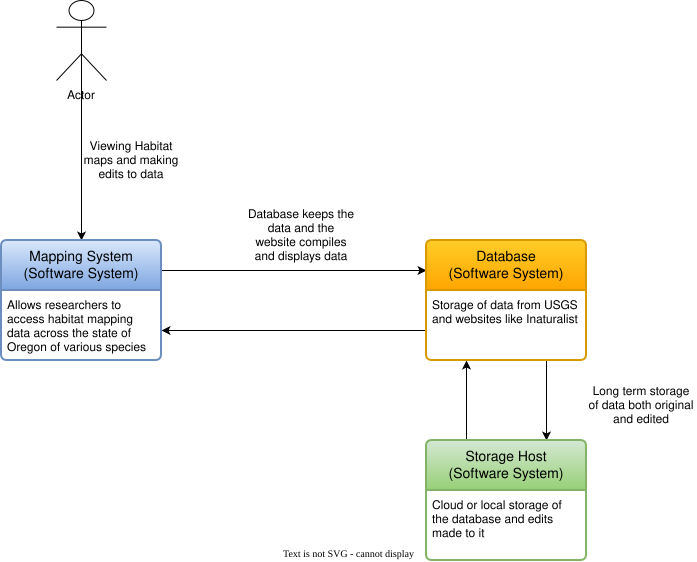
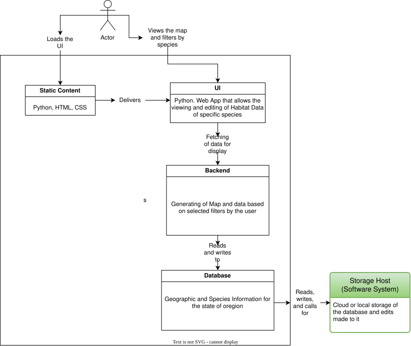

### Technical Design


```
Front-end and back-end language: Python
Main front-end library for mapping and data manipulation: GeoPandas, Rasterio
Front-end Frameworks: React, Python GUI, Svelte
Backend Libraries/APIs: Shapely, Pyproj, Pyogiro, NumPy, Pandas, Matplotlib, GDAL
Deployment (Long-term): Locally hosted web app
```
**Database and data storage solutions are still being investigated and will be decided.**

Deployment (Fall term): Per the recommendation and agreement with our Project Partner, Logan Sizemore, we plan to not have a deployed prototype this term and will instead focus our energy on the design process and architecture.

## User Context Diagram 1

<picture>
 <source media="(prefers-color-scheme: dark)" srcset="https://github.com/kathryn-flinn-19/Habitat-Maps-for-ODFW/blob/ADaggett-patch-1/Content%20Diagram%201.svg">
 <source media="(prefers-color-scheme: light)" srcset="https://github.com/kathryn-flinn-19/Habitat-Maps-for-ODFW/blob/ADaggett-patch-1/Content%20Diagram%201.svg">
 
</picture>

## User Context Diagram 2

<picture>
 <source media="(prefers-color-scheme: dark)" srcset="https://github.com/kathryn-flinn-19/Habitat-Maps-for-ODFW/blob/ADaggett-patch-1/Content%20Diagram%202.drawio.svg">
 <source media="(prefers-color-scheme: light)" srcset="https://github.com/kathryn-flinn-19/Habitat-Maps-for-ODFW/blob/ADaggett-patch-1/Content%20Diagram%202.drawio.svg">
 
</picture>
